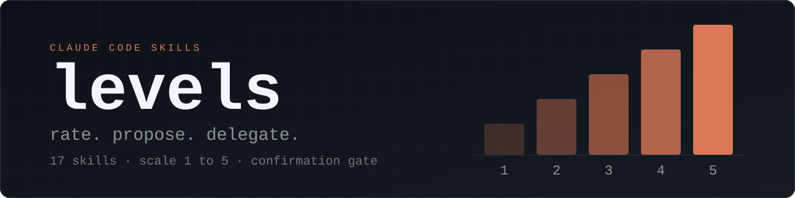

<p align="center">
  
</p>

# Levels

Levels is a set of seventeen skills for Claude Code. Each layer skill rates one part of a project (interface, backend, tests, security and so on) on a scale from 1 to 5, shows what is missing for the level you choose, and proposes options. If you ask it to build, it splits the work into small sub-plans and hands them to cheaper models, after showing you the plan and asking first.

**Status: new and untested.** See [Status of testing](#status-of-testing) before you rely on any of this.

## Install

Use one method, not both. Installing both gives you every skill twice.

### As a plugin

```bash
claude plugin marketplace add codezeroexe/levels
```

```bash
claude plugin install levels@levels
```

Plugin skills carry the plugin name as a prefix. The conductor is `/levels:levels`, the design skill is `/levels:design-level`, and so on.

### By copying folders

```bash
git clone https://github.com/codezeroexe/levels.git
```

```bash
cp -R levels/skills/* ~/.claude/skills/
```

Skills installed this way have no prefix: `/levels`, `/design-level`. To update, pull and copy again. The copy replaces the seventeen folders and leaves your other skills alone.

The rest of this page writes commands without the prefix. Add `levels:` if you installed the plugin.

## Quick start

In a project folder, run:

```
/levels
```

It shows where the project stands, asks what you want to do with a tick-box prompt, proposes a target level for each skill you picked, and waits for you to confirm. It then runs the skills in a fixed order and asks before each one.

Other ways in:

- `/levels-help` explains the set. It changes nothing.
- `/levels-status` shows every recorded level and open gap. It changes nothing.
- `/levels-next` recommends one next step.
- `/test-level 3 audit` runs one skill directly, here the test skill against level 3.

Layer skills start in `audit` mode unless you say `build`. An audit rates and proposes. It does not edit product code.

## Skills

<!-- skills-table:start -->
| Skill | Use it to |
|---|---|
| `levels` | Run several skills as one workflow |
| `levels-status` | See every level and open gap in one table |
| `levels-next` | Get the single best next step |
| `levels-help` | Read the guide |
| `idea-level` | Find or sharpen a project idea, up to a build-ready blueprint |
| `ux-level` | Check whether users can finish their tasks |
| `restyle-level` | See alternative looks and layouts as mockups |
| `design-level` | Raise the quality of the interface |
| `backend-level` | Harden the server, logic and edge cases |
| `data-level` | Fix stored data shape, integrity and migrations |
| `test-level` | Prove the product works |
| `security-level` | Find and close security weaknesses |
| `perf-level` | Measure and improve speed |
| `code-level` | Clean up structure without changing behaviour |
| `docs-level` | Make documentation accurate and usable |
| `ship-level` | Prepare a safe, repeatable release |
| `pitch-level` | Prepare a demo, talk or submission |
<!-- skills-table:end -->

Two skills use different mode names: `idea-level` takes `ideas` or `develop`, and `restyle-level` takes `explore` or `refine`. Run `/levels-help <skill>` for the arguments of one skill.

## How a run goes

A layer skill follows these steps:

1. **Context.** It reads the project, then asks you only what it could not find, in at most two rounds.
2. **Audit.** It states the level the project is at now, with evidence, and lists the gaps.
3. **Options.** For the main gaps it gives two or three choices with their costs and marks one as recommended. Then it stops and waits. In `audit` mode the run ends here.
4. **Plan.** In `build` mode it splits what you chose into sub-plans. The number follows the size of the work.
5. **Delegation gate.** It shows which model will do each sub-plan and asks before anything runs.
6. **Execution.** Sub-plans run on the models you approved.
7. **Review.** It checks the result, runs at most one corrective round, and reports what moved, what is still open and what it could not verify.

Level 5 is not the goal. The skills are written to tell you when a target is too high for the product.

Accessibility requirements (WCAG AA contrast, keyboard access, visible focus) are off by default. Pass `a11y` to `design-level` or `restyle-level` to turn them on.

## Models and cost

- Context, audit, options, planning and review are written to run on Opus. The skills set `model: opus` in their frontmatter.
- Execution is delegated to Haiku, or to Sonnet where the work cannot be fully written out in advance. `restyle-level` is the exception and defaults to Sonnet for first screens.
- Before any sub-plan runs, the skill prints a line such as `Delegation: 6 sub-plans on Haiku, 2 on Sonnet. Review on Opus.` and offers four choices: delegate as planned, Haiku only, Sonnet for all, or no delegation. `data-level` and `security-level` replace "Haiku only" with "Haiku where allowed", because they keep migrations and sign-in work off Haiku.
- A skill's `model` setting changes the model of your session for the rest of that turn. `levels-help` and `levels-status` set Haiku, `levels-next` sets Sonnet, and the rest set Opus.
- If the session cannot use Opus, the skill says which model is running and asks whether to continue or stop.
- Nothing builds until you answer. A skill started by another skill asks again.
- An Opus audit of a large project uses a lot of tokens. To spend least: run audits only, pick few gaps and keep the target level modest.

This project publishes no cost figures, because none have been measured.

## Safety limits

These limits are instructions in the skill text. They are not enforced by code, so read the plan at the delegation gate before you approve it.

- No skill deploys or acts on a live system. Steps on a live system are written out for you to run, with a way back.
- No skill works on real data. `data-level` works on a copy.
- `test-level` writes tests only and does not change product code.
- `code-level` changes structure only and does not change behaviour.
- `restyle-level` writes mockups under `mockups/` and does not edit product code.
- `docs-level` and `pitch-level` do not change product code.
- `security-level` works on your own project in a local copy. It does not probe live systems and does not print secret values.
- One skill may offer to start another. It asks first, and the skill it starts does not start a third.

## The LEVELS.md record

The skills keep one file, `LEVELS.md`, in the root of your project. It starts with a levels block that tools can read:

```
<!-- levels
design: 3/4 gaps=5
backend: 2/3 gaps=12
-->
```

Below the block, each skill keeps a section with its profile, findings and date, so later skills do not ask the same questions again. The format, including the parts that are not yet fixed, is described in [docs/levels-md-format.md](docs/levels-md-format.md). A filled-in example is in [docs/example-LEVELS.md](docs/example-LEVELS.md).

## Status of testing

Version 0.1.0.

Checked:

- `claude plugin validate . --strict` passes for the marketplace manifest, the plugin manifest and the `skills/` folder (Claude Code 2.1.296).
- `python3 scripts/validate.py` passes.
- The `model` setting in the frontmatter changes the session model as described above.

Not checked:

- Only `levels-help`, `levels-status`, `levels-next`, `design-level`, `backend-level` and `test-level` have been run, once each, on one small sample project. `test-level` is the only skill run in `build` mode. The person testing answered the skills' questions in place of a user.
- The other eleven skills, including the `levels` conductor and its cross-layer check, have not been run.
- The path for sessions that cannot use Opus has not been run.
- Installing through the marketplace has not been tried from the published repository.
- Handoffs between skills, and the conductor suppressing handoffs in the skills it calls, have not been observed in a real run.
- The `LEVELS.md` format has gaps, listed in the format page.

Expect rough edges. Use `audit` mode first, and use version control so any change can be undone.

## Reporting problems

Open an issue at <https://github.com/codezeroexe/levels/issues>. There is a template for a bug in a skill and one for proposing a new skill. For a bug, include the skill name, the exact command, your Claude Code version, how you installed the set, and what the skill did against what its `SKILL.md` says.

To contribute, read [CONTRIBUTING.md](CONTRIBUTING.md).

## Credits

The simplification ladder in `code-level` is adapted from the [ponytail](https://github.com/DietrichGebert/ponytail) plugin by Dietrich Gebert, which is MIT licensed.

`restyle-level` borrows from the [impeccable](https://github.com/pbakaus/impeccable) project by Paul Bakaus, which is licensed under Apache 2.0. Copies of its licence and notice file are in [third-party/](third-party/).

## Licence

MIT. See [LICENSE](LICENSE).
