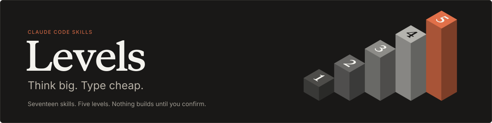
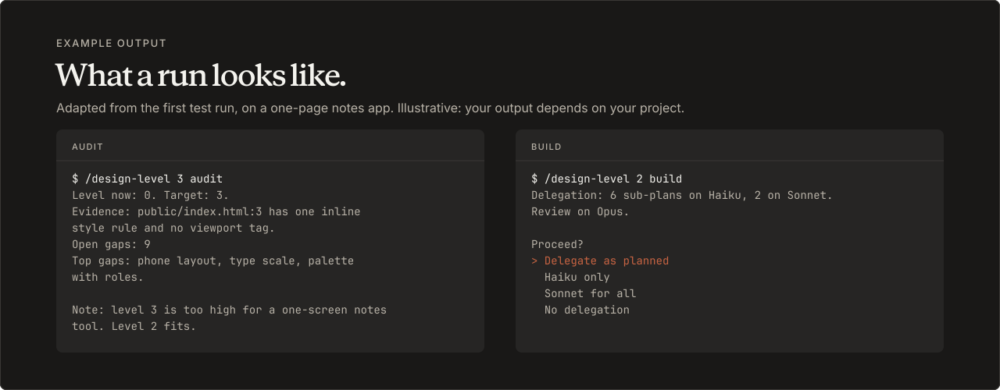
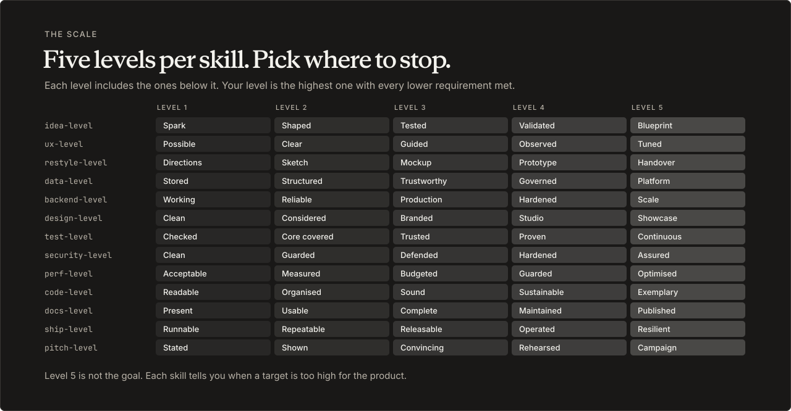
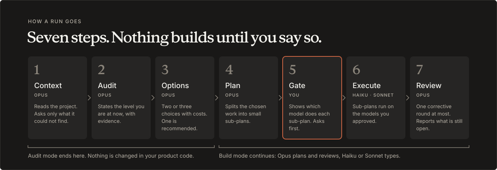
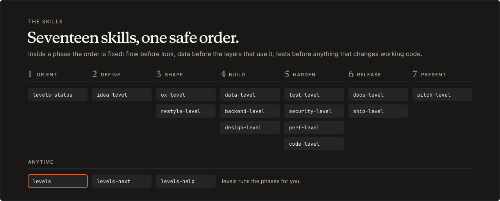

<p align="center">
  
</p>

<p align="center">
  <a href="LICENSE"></a>
  <a href="https://github.com/codezeroexe/levels/actions/workflows/validate.yml"></a>
</p>

<p align="center">
  <a href="#see-it-run">See it run</a> ·
  <a href="#install">Install</a> ·
  <a href="#quick-start">Quick start</a> ·
  <a href="#why-levels">Why Levels</a> ·
  <a href="#the-levels">The levels</a> ·
  <a href="#how-a-run-goes">How a run goes</a> ·
  <a href="#skills">Skills</a> ·
  <a href="#faq">FAQ</a>
</p>

# Levels

Levels is a set of seventeen skills for Claude Code. Each layer skill rates one part of a project (interface, backend, tests, security and so on) on a scale from 1 to 5, shows what is missing for the level you choose, and proposes options. If you ask it to build, it splits the work into small sub-plans and hands them to cheaper models, after showing you the plan and asking first.

## See it run

<p align="center">
  
</p>

<details>
<summary>The example output as text</summary>

```
$ /design-level 3 audit
Level now: 0. Target: 3.
Evidence: public/index.html:3 has one inline style rule and no viewport tag.
Open gaps: 9
Top gaps: phone layout, type scale, palette with roles.

Note: level 3 is too high for a one-screen notes tool. Level 2 fits.
```

```
$ /design-level 2 build
Delegation: 6 sub-plans on Haiku, 2 on Sonnet. Review on Opus.

Proceed?
> Delegate as planned
  Haiku only
  Sonnet for all
  No delegation
```

</details>

This is example output, adapted from the [first test run](docs/example-LEVELS.md) on a one-page notes app. The delegation counts in the build panel are illustrative. Your output depends on your project.

## Install

| You use | Install with | Start a skill with |
|---|---|---|
| Claude Code | [the plugin](#claude-code-as-a-plugin) or [copied folders](#claude-code-by-copying-folders) | `/levels` (plugin: `/levels:levels`) |
| Codex CLI | [the installer](#other-agents) | `$levels` |
| Gemini CLI | [the installer](#other-agents) | ask for the skill by name, for example "run the levels skill" |
| opencode, Cursor, GitHub Copilot CLI | [the installer](#other-agents) | `/levels` |

### Claude Code: as a plugin

Use one Claude Code method, not both. Installing both gives you every skill twice.

```bash
claude plugin marketplace add codezeroexe/levels
```

```bash
claude plugin install levels@levels
```

Plugin skills carry the plugin name as a prefix. The conductor is `/levels:levels`, the design skill is `/levels:design-level`, and so on.

### Claude Code: by copying folders

```bash
git clone https://github.com/codezeroexe/levels.git
```

```bash
cp -R levels/skills/* ~/.claude/skills/
```

Skills installed this way have no prefix: `/levels`, `/design-level`. To update, pull and copy again. The copy replaces the seventeen folders and leaves your other skills alone.

The rest of this page writes commands without the prefix. Add `levels:` if you installed the plugin.

### Other agents

The installer sets up Codex CLI, Gemini CLI, opencode, Cursor and GitHub Copilot CLI. It needs Node 18 or newer.

1. Run it:

   ```bash
   npx github:codezeroexe/levels
   ```

   On npm 12 or newer, git packages are off by default. Use `npx --allow-git=root github:codezeroexe/levels` instead. From a clone, run `node install.js`.

2. It finds the agents on your machine and installs for each one. To pick agents yourself, add `-- --only codex,gemini`. To see what it would change first, add `-- --dry-run`.
3. For opencode, Cursor and Copilot it asks for three models: Planner, Heavy and Light (see below). Press Enter to skip. The first run of a skill then asks, and can save the choice for that project.
4. Start a new session in each agent so it loads the skills.

To update, run the same command again. To remove everything it wrote, add `-- --uninstall`. To remove one agent, add `-- --uninstall --only <agent>`.

#### What it writes

- The seventeen skills, once, to `~/.agents/skills`. All five agents read that folder. Each copy is translated on the way: the Claude model names become three roles, and the skill gets a table of the models each installed agent uses.
- Two executor sub-agents, `levels-heavy` and `levels-light`, in each agent's own folder and format.
- With `--project`, the same files go into the current project instead of your home folder.

It never replaces a folder or file it did not write, including symlinks. If it finds one, it stops and changes nothing. `--force` replaces them.

#### Models

| Agent | Planner (your session) | Heavy | Light |
|---|---|---|---|
| Codex CLI | `gpt-6.1-sol`, reasoning effort high, or `gpt-6-astra` (costs more) | `gpt-6.1-sol`, reasoning effort medium | `gpt-6-luna` |
| Gemini CLI | `gemini-4-argon` | `gemini-3.8-flash` | `gemini-3.5-flash-lite` |
| opencode, Cursor, Copilot | your choice | your choice | your choice |

The Planner takes the place of Opus, Heavy of Sonnet and Light of Haiku. The Planner is the model your session runs on. In Codex, `gpt-6-astra` is accepted as Planner too. It is OpenAI's most capable Codex model and costs more than `gpt-6.1-sol`, so a skill started on Astra asks first whether to continue on it. To set models without the prompt, pass `--models <agent>=<planner>,<heavy>,<light>`, for example `--models opencode=anthropic/claude-opus-5-5,anthropic/claude-sonnet-5-5,anthropic/claude-haiku-5-5`. This also overrides the Codex and Gemini defaults.

#### Options

| Option | Does |
|---|---|
| `--list` | Show the supported agents and which were found. |
| `--only a,b` | Install for these agents only: `codex`, `gemini`, `opencode`, `cursor`, `copilot`. |
| `--all` | Install for all five, found or not. |
| `--models a=p,h,l` | Set the Planner, Heavy and Light models for one agent. |
| `--project` | Install into the current project. |
| `--dry-run` | Print what would change. |
| `--uninstall` | Remove what the installer wrote. |
| `--yes` | Ask no questions. |
| `--force` | Replace folders the installer did not write. |

#### Known limits

- Gemini CLI's model page lists older model IDs than the Gemini API page. If a sub-agent does not start, pass your own with `--models gemini=...`.
- Skill arguments, the question prompts and sub-agent delegation depend on each agent. Where an agent cannot start a named sub-agent, the skill offers to run without delegation.
- opencode and Cursor also read `~/.claude/skills`. If you copied the skills there for Claude Code, they will list each skill twice.

## Quick start

In a project folder, run:

```
/levels
```

It shows where the project stands, asks what you want to do with a tick-box prompt, proposes a target level for each skill you picked, and waits for you to confirm. It then runs the skills in a fixed order and asks before each one.

Other ways in:

- `/levels-help` explains the set. It changes nothing.
- `/levels-status` shows every recorded level and open gap. It changes nothing.
- `/levels-next` recommends one next step.
- `/test-level 3 audit` runs one skill directly, here the test skill against level 3.
- `/levels release` runs the checks before a release: tests, security, documentation and release steps.
- `/design-level 3 audit` rates the interface against level 3 and lists the gaps.
- `/backend-level 4 build server/` audits the `server/` folder, then plans and builds to level 4.

Layer skills start in `audit` mode unless you say `build`. An audit rates and proposes. It does not edit product code.

## Why Levels

**"Make it better" has no finish line.** Every skill has five named levels, so a target is a place you can name. For the interface they are Clean, Considered, Branded, Studio and Showcase. The skill states the level you are at now, with evidence from your files, and lists what separates you from the level you chose.

**The expensive model should think, not type.** Opus, or Fable if you pick it, handles context, audit, options, planning and review. Haiku, or Sonnet where the work cannot be fully written out in advance, does the execution, one small sub-plan at a time. See [Models and cost](#models-and-cost).

**Nothing builds until you say so.** Skills audit first. They stop after the options and wait. Before any sub-plan runs, a gate shows which model will do which piece and asks you. A skill started by another skill asks again.

**It tells you when to stop.** Level 5 is not the goal. The skills are written to say when a target is too high for the product. In the [first test run](docs/example-LEVELS.md), the interface audit of a one-screen notes tool noted that level 3 was too high and level 2 fit.

## The levels

<p align="center">
  
</p>

<details>
<summary>The levels as a table</summary>

| Skill | 1 | 2 | 3 | 4 | 5 |
|---|---|---|---|---|---|
| `idea-level` | Spark | Shaped | Tested | Validated | Blueprint |
| `ux-level` | Possible | Clear | Guided | Observed | Tuned |
| `restyle-level` | Directions | Sketch | Mockup | Prototype | Handover |
| `data-level` | Stored | Structured | Trustworthy | Governed | Platform |
| `backend-level` | Working | Reliable | Production | Hardened | Scale |
| `design-level` | Clean | Considered | Branded | Studio | Showcase |
| `test-level` | Checked | Core covered | Trusted | Proven | Continuous |
| `security-level` | Basic | Guarded | Defended | Hardened | Assured |
| `perf-level` | Acceptable | Measured | Budgeted | Guarded | Optimised |
| `code-level` | Readable | Organised | Sound | Sustainable | Exemplary |
| `docs-level` | Present | Usable | Complete | Maintained | Published |
| `ship-level` | Runnable | Repeatable | Releasable | Operated | Resilient |
| `pitch-level` | Stated | Shown | Convincing | Rehearsed | Campaign |

</details>

- Each level includes everything in the levels below it.
- Your current level is the highest level whose requirements, and those of every level below it, are all met.
- A project that does not meet level 1 is recorded as level 0. Requirements already met above your level are listed as ahead.

## How a run goes

<p align="center">
  
</p>

A layer skill follows these steps:

1. **Context.** It reads the project, then asks you only what it could not find, in at most two rounds.
2. **Audit.** It states the level the project is at now, with evidence, and lists the gaps.
3. **Options.** For the main gaps it gives two or three choices with their costs and marks one as recommended. Then it stops and waits. In `audit` mode the run ends here.
4. **Plan.** In `build` mode it splits what you chose into sub-plans. The number follows the size of the work.
5. **Delegation gate.** It shows which model will do each sub-plan and asks before anything runs.
6. **Execution.** Sub-plans run on the models you approved.
7. **Review.** It checks the result, runs at most one corrective round, and reports what moved, what is still open and what it could not verify.

Accessibility requirements (WCAG AA contrast, keyboard access, visible focus) are off by default. Pass `a11y` to `design-level` or `restyle-level` to turn them on.

## Skills

<p align="center">
  
</p>

`/levels` runs the phases in this order and asks before each skill. Skip a phase that does not apply: a project with no interface skips Shape, and a tool nobody else will run skips Release.

<details>
<summary>All seventeen skills, and what each one does</summary>

<!-- skills-table:start -->
| Skill | Use it to |
|---|---|
| `levels` | Run several skills as one workflow |
| `levels-status` | See every level and open gap in one table |
| `levels-next` | Get the single best next step |
| `levels-help` | Read the guide |
| `idea-level` | Find or sharpen a project idea, up to a build-ready blueprint |
| `ux-level` | Check whether users can finish their tasks |
| `restyle-level` | See alternative looks and layouts as mockups |
| `design-level` | Raise the quality of the interface |
| `backend-level` | Harden the server, logic and edge cases |
| `data-level` | Fix stored data shape, integrity and migrations |
| `test-level` | Prove the product works |
| `security-level` | Find and close security weaknesses |
| `perf-level` | Measure and improve speed |
| `code-level` | Clean up structure without changing behaviour |
| `docs-level` | Make documentation accurate and usable |
| `ship-level` | Prepare a safe, repeatable release |
| `pitch-level` | Prepare a demo, talk or submission |
<!-- skills-table:end -->

</details>

Two skills use different mode names: `idea-level` takes `ideas` or `develop`, and `restyle-level` takes `explore` or `refine`. Run `/levels-help <skill>` for the arguments of one skill.

### Shortcuts for `/levels`

Pass a route to skip the question prompt: `/levels <route> [audit|build]`.

| Route | What it runs |
|---|---|
| `new` | Define, Shape, Build, Harden and Release |
| `raise` | The skills `levels-next` ranks highest, one at a time |
| `redesign` | Shape, then `design-level` in `build` mode, then `test-level` |
| `release` | `test-level`, `security-level`, then Release |
| `present` | `pitch-level` only |

## Models and cost

Think big, type cheap:

- Context, audit, options, planning and review are written to run on Opus. The skills set `model: inherit`, so they run on the model you picked with `/model`. Fable is allowed but never chosen for you: it costs more per token and may bill to usage credits.
- Execution is delegated to Haiku, or to Sonnet where the work cannot be fully written out in advance. `restyle-level` is the exception and defaults to Sonnet for first screens.
- Before any sub-plan runs, the skill prints a line such as `Delegation: 6 sub-plans on Haiku, 2 on Sonnet. Review on Opus.` and offers four choices: delegate as planned, Haiku only, Sonnet for all, or no delegation. `data-level` and `security-level` replace "Haiku only" with "Haiku where allowed", because they keep migrations and sign-in work off Haiku.
- A skill's `model` setting changes the model of your session for the rest of that turn. `levels-help` and `levels-status` set Haiku, `levels-next` sets Sonnet, and the rest keep your session model.
- On Opus the skill starts without asking. On Fable, which shows you have access, it says that Fable costs more and asks whether to continue on Fable or rerun on Opus. On any other model it says which model is running and asks whether to continue or stop.
- Nothing builds until you answer. A skill started by another skill asks again.
- An Opus audit of a large project uses a lot of tokens. To spend least: run audits only, pick few gaps and keep the target level modest.

## Safety limits

These limits are instructions in the skill text. They are not enforced by code, so read the plan at the delegation gate before you approve it.

- No skill deploys or acts on a live system. Steps on a live system are written out for you to run, with a way back.
- No skill works on real data. `data-level` works on a copy.
- `test-level` writes tests only and does not change product code.
- `code-level` changes structure only and does not change behaviour.
- `restyle-level` writes mockups under `mockups/` and does not edit product code.
- `docs-level` and `pitch-level` do not change product code.
- `security-level` works on your own project in a local copy. It does not probe live systems and does not print secret values.
- One skill may offer to start another. It asks first, and the skill it starts does not start a third.

## The LEVELS.md record

The skills keep one file, `LEVELS.md`, in the root of your project. It starts with a levels block that tools can read:

```
<!-- levels
design: 3/4 gaps=5
backend: 2/3 gaps=12
-->
```

Below the block, each skill keeps a section with its profile, findings and date, so later skills do not ask the same questions again. The format, including the parts that are not yet fixed, is described in [docs/levels-md-format.md](docs/levels-md-format.md). A filled-in example is in [docs/example-LEVELS.md](docs/example-LEVELS.md).

## FAQ

**Will it change my code?** Not in `audit` mode. In `build` mode, only after you pick options and approve the delegation gate.

**Can I stop halfway?** Yes. Progress is kept in `LEVELS.md`. Run `/levels` again to resume.

**Do I need every skill?** No. Skip what does not apply. The skills say so when a requirement does not fit the product.

**What does it cost?** It depends on the project and the plan. Each sub-plan starts an agent with its own start-up cost, so for a plan of three sub-plans or fewer the gate says that no delegation may cost less. To spend least, run audits only, pick few gaps and keep the target level modest.

**Which models does it use?** Opus for thinking and review, or Fable if you choose it, and Haiku or Sonnet for execution. See [Models and cost](#models-and-cost).

**Does it work with other agents?** Levels is written for Claude Code. The installer in [Other agents](#other-agents) adapts it for Codex CLI, Gemini CLI, opencode, Cursor and GitHub Copilot CLI. How well each agent follows the skills is unconfirmed.

**It asked for a level I do not understand.** Run `/levels-help <skill>` to see that skill's five levels.

**A skill is missing.** The others still work. Handoffs to a missing skill stop and tell you.

## Reporting problems

Open an issue at <https://github.com/codezeroexe/levels/issues>. There is a template for a bug in a skill and one for proposing a new skill. For a bug, include the skill name, the exact command, your Claude Code version, how you installed the set, and what the skill did against what its `SKILL.md` says.

To contribute, read [CONTRIBUTING.md](CONTRIBUTING.md). If Levels is useful to you, a star helps other people find it.

## Credits

The simplification ladder in `code-level` is adapted from the [ponytail](https://github.com/DietrichGebert/ponytail) plugin by Dietrich Gebert, which is MIT licensed.

`restyle-level` borrows from the [impeccable](https://github.com/pbakaus/impeccable) project by Paul Bakaus, which is licensed under Apache 2.0. Copies of its licence and notice file are in [third-party/](third-party/).

## Star History

<a href="https://www.star-history.com/?repos=codezeroexe%2Flevels&type=date&legend=top-right">
 <picture>
   <source media="(prefers-color-scheme: dark)" srcset="https://api.star-history.com/chart?repos=codezeroexe/levels&type=date&theme=dark&legend=top-left" />
   <source media="(prefers-color-scheme: light)" srcset="https://api.star-history.com/chart?repos=codezeroexe/levels&type=date&legend=top-left" />
   
 </picture>
</a>

## Licence

MIT. See [LICENSE](LICENSE).
